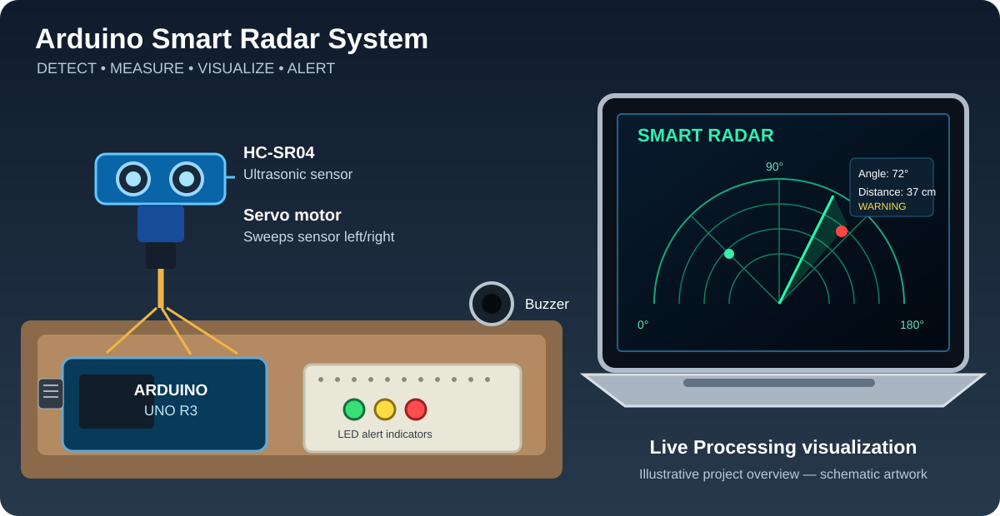
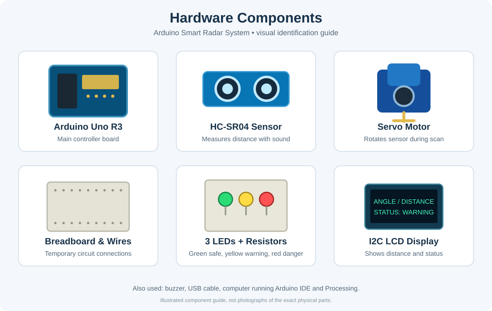
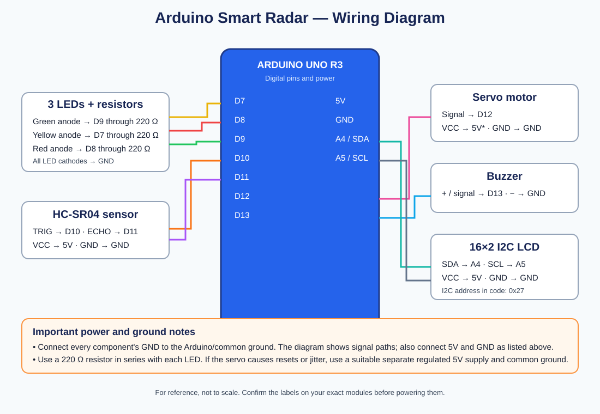

# Arduino Smart Radar System



An illustrated overview of the complete project and its live radar visualization. The artwork is a schematic illustration, not a photograph of the exact assembled circuit.

An Arduino Uno R3 radar project that scans for nearby objects using an HC-SR04 ultrasonic sensor mounted on a servo motor. The system displays the scan in Processing on a computer and gives local distance feedback through three LEDs, a buzzer, and a 16×2 I2C LCD.

## Features

- Scans from 15° to 165° with a servo-mounted ultrasonic sensor.
- Measures object distance and sends `angle,distance.` readings to Processing over serial at 9600 baud.
- Displays a live radar screen in Processing.
- Uses LEDs and buzzer for distance alerts:
  - **SAFE:** distance greater than 50 cm — green LED.
  - **WARNING:** distance from 8 cm through 50 cm — yellow LED and slow beeps.
  - **DANGER:** distance of 7 cm or less — red LED and faster beeps.
- Shows distance and status on a 16×2 I2C LCD.
- If the ultrasonic sensor receives no echo, the Arduino reports 999 cm (treated as out of range).

## Hardware Components



The reference image labels the main parts used in this project. It is an illustration rather than a photo of the exact physical components.

- Arduino Uno R3
- HC-SR04 ultrasonic distance sensor
- SG90-compatible servo motor
- 16×2 LCD with I2C backpack (address configured as `0x27`)
- 1 green LED, 1 yellow LED, 1 red LED
- 3 × 220 Ω resistors (one for each LED)
- Buzzer
- Breadboard and jumper wires
- USB cable for the Arduino
- Computer running Arduino IDE and Processing

## Wiring guide

Open [wiring-diagram.svg](wiring-diagram.svg) for a visual wiring reference, or view it below.\n\n

| Component | Component pin | Arduino connection |
|---|---|---|
| HC-SR04 | VCC | 5V |
| HC-SR04 | GND | GND |
| HC-SR04 | TRIG | Digital pin 10 |
| HC-SR04 | ECHO | Digital pin 11 |
| Servo motor | Signal (orange/yellow) | Digital pin 12 |
| Servo motor | VCC (usually red) | 5V* |
| Servo motor | GND (usually brown/black) | GND |
| Green LED | Anode (+), through 220 Ω resistor | Digital pin 9 |
| Yellow LED | Anode (+), through 220 Ω resistor | Digital pin 7 |
| Red LED | Anode (+), through 220 Ω resistor | Digital pin 8 |
| Each LED | Cathode (−) | GND |
| Buzzer | + / signal | Digital pin 13 |
| Buzzer | − | GND |
| I2C LCD | VCC | 5V |
| I2C LCD | GND | GND |
| I2C LCD | SDA | A4 on Uno R3 |
| I2C LCD | SCL | A5 on Uno R3 |

**Important:** All components must share a common GND. LED anodes must connect to their Arduino pins through resistors; do not connect LEDs directly without current-limiting resistors. Servo wire colors can vary, so check the label/datasheet for your specific servo. If the servo causes resets, jitter, or an unstable LCD, use a suitable separate regulated 5V supply for the servo and connect its ground to Arduino GND. Do not power a servo from an unsuitable supply.

## Software

- [Arduino IDE — official download](https://www.arduino.cc/en/software)
- [Processing — official download](https://processing.org/download)
- Arduino library: **Servo** (usually included with Arduino IDE)
- Arduino library: **LiquidCrystal_I2C** (install a compatible version using Library Manager or the library's instructions)

## How to run

1. Wire the components using the table and diagram.
2. Open `arduino/Radar_System_Arduino.ino` in Arduino IDE.
3. Install a compatible `LiquidCrystal_I2C` library if it is not already installed.
4. Select **Arduino Uno** and the correct serial port in Arduino IDE, then upload the sketch.
5. Close Arduino IDE's **Serial Monitor** before opening Processing, because both programs cannot normally use the same serial port at once.
6. Open `processing/Radar_System_Processing.pde` in Processing.
7. Check the port name near the top of the Processing sketch. It is currently set to `COM3` for the original setup. Change it to the port shown for your Arduino if needed.
8. Run the Processing sketch. Keep the baud rate at **9600** in both programs.

## Serial data format

Arduino sends one reading per line in this format:

```text
angle,distance.
```

Example: `90,24.` means the sensor is pointing at 90° and measured an object 24 cm away.

## Troubleshooting

- **Processing cannot open COM3:** select the correct port in the Processing sketch. Close Arduino Serial Monitor and any other application using the port.
- **LCD has no text:** check SDA=A4, SCL=A5, power, contrast adjustment, and I2C address. This sketch uses `0x27`; some LCD backpacks use `0x3F`.
- **Servo or LCD behaves erratically:** check common ground and power capacity; consider a separate regulated servo supply.
- **Yellow LED does not light:** confirm the yellow LED is wired to pin 7 through a resistor, its cathode goes to GND, and the measured distance is between 8 and 50 cm.
- **Radar does not show an object:** keep objects within 50 cm for the red object marker; verify the HC-SR04 wiring and serial data.

## Project files

- `arduino/Radar_System_Arduino.ino` — sensor scan, LEDs, buzzer, LCD, and serial output.
- `processing/Radar_System_Processing.pde` — computer radar visualization.
- `wiring-diagram.svg` — visual connection reference.
- `images/radar-system-overview.svg` — project overview illustration.
- `images/hardware-components.svg` — illustrated component identification guide.

This is an educational prototype for learning embedded systems, sensors, serial communication, and visualisation. It is not a certified safety or security device.
